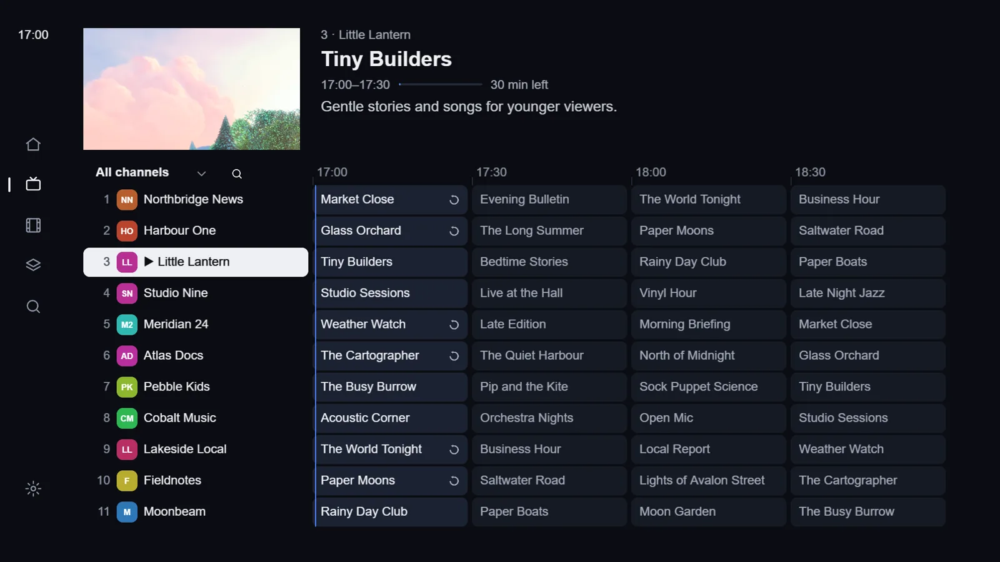
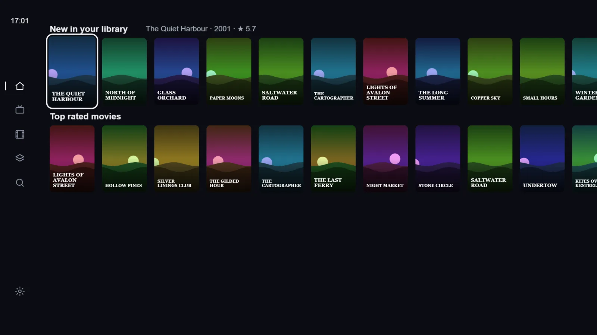
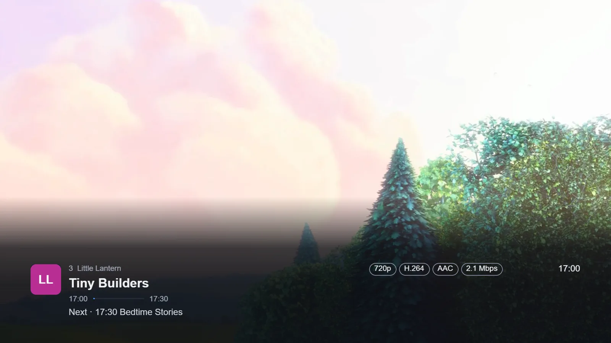
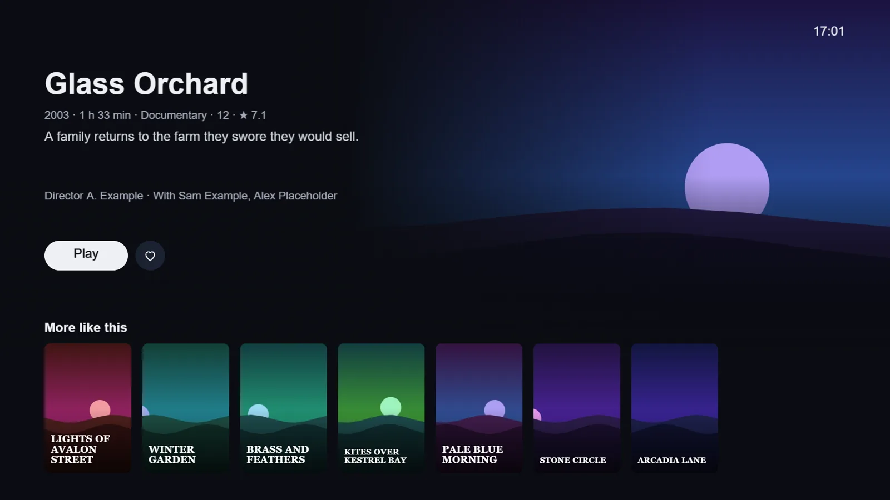
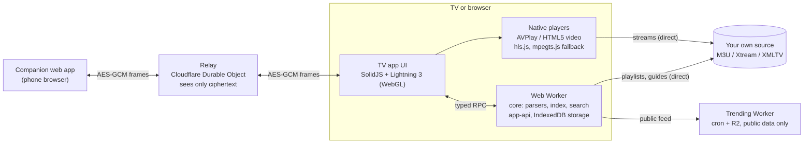

# Saqqezy Player

**A fast TV player for your own playlists and TV guides. It ships with no content.**

[](https://github.com/Saccor/iptv-app/actions/workflows/ci.yml)




You bring your own source: an M3U playlist, an Xtream login or an XMLTV guide. Examples are your own media server,
free-to-air channels, or a playlist your operator gives you. The app is a TV web app with a remote-first UI. It runs
in a desktop browser and packages for Samsung Tizen TVs. It has been installed and profiled on one Samsung Tizen
device (an Odyssey G9 monitor); other TVs are untested. A phone can manage it over an end-to-end encrypted link.

| | |
|---|---|
|  |  |
|  |  |

<sub>Every channel, programme and title above is made up and drawn by the bundled fake provider. The video is
<i>Big Buck Bunny</i> (© Blender Foundation, <a href="https://creativecommons.org/licenses/by/3.0/">CC BY 3.0</a>).</sub>

## Features

- **Live TV:** a channel list beside a TV guide grid, live preview, number entry, previous channel, favourites
  and lists, hidden and renamed channels, and catch-up where the source offers it.
- **Multiview:** up to six channels at once in desktop browsers, and two on Samsung TVs whose player allows a
  second picture. Each window uses one connection from your source.
- **Movies and series** from Xtream sources: resume, duplicate versions folded into one title, audio and subtitle
  tracks, subtitles from a file, a link or OpenSubtitles with sync and delay.
- **Start page:** continue watching, what is on now in your own guide, and new and top-rated titles in your library.
- **Search** across channels, programmes, movies and series.
- **Phone companion:** scan a QR code on the TV, then add sources and edit lists from a phone browser.
- **Remote-first:** every screen works with a D-pad, OK and Back. Mouse and pointer work too.
- **Gentle on sources:** retries back off, and a refusal starts a cooldown instead of a retry loop.

## Architecture



Media, playlists and guides go straight from your source to the device. Our servers never proxy, relay or cache
them. The relay forwards encrypted frames between one TV and one phone and stores nothing. The trending Worker
publishes a public feed built from Wikimedia and Wikidata data, so it never sees anything about you.

More detail: [Architecture](docs/ARCHITECTURE.md) · [Security model](docs/SECURITY-MODEL.md) ·
[Decisions](docs/DECISIONS.md) · [Lessons](docs/LESSONS.md)

## Technical highlights

- **End-to-end encrypted pairing.** A QR code carries a random session id and AES-256-GCM key in the URL
  fragment. A typed code is stretched with PBKDF2-SHA256 (200,000 iterations) into both. Keys are non-extractable,
  and every frame has a random IV, authenticated header data and
  replay protection ([`packages/companion-protocol`](packages/companion-protocol/src)).
- **A relay that cannot read anything.** A Cloudflare Durable Object per pairing forwards opaque binary frames,
  with limits on size, rate, bytes and lifetime. Its new-session limiter keys on hashes of the address prefix,
  never the raw IP ([`services/relay`](services/relay)).
- **Parsing off the UI thread.** M3U, Xtream and a streaming XMLTV parser run in a Web Worker behind a typed RPC.
  A 100 MB guide streams in with bounded memory, and a 54k-channel guide import keeps the API answering
  (p95 under 15 ms).
- **Built for 50k+ channels.** The channel list, the guide grid and the poster rows are virtualised, so only
  visible rows exist. Indexing 50k channels with layout edits takes under 300 ms, and the index work for a zap takes under 20 ms.
  Logos and posters are held in LRU caches.
- **Playback that recovers.** A supervisor in [`packages/player`](packages/player/src) handles reconnects with a
  budget, a stall watchdog, live delay and a TS ↔ HLS fallback. Native players come first, and hls.js / mpegts.js
  are only a fallback.
- **Fast first frame.** Screens that are never needed first (settings, multiview, the film player) load lazily,
  and a build check on the source maps names any module that leaks into the start bundle. A cached start reopens the last channel.
- **Tests as specification.** 4,722 Vitest tests run on synthetic fixtures. 26 performance budgets run as tests
  (`pnpm test:perf`), and strict TypeScript covers every package.

## Quick start (about 5 minutes)

Needs Node 22+ and pnpm 10 (`corepack enable`).

```bash
pnpm install
pnpm dev
```

1. `pnpm dev` starts a fake provider on `http://127.0.0.1:8899` with 200 synthetic channels, a guide and a film
   library, plus the app on http://localhost:5173. Open the app in Chrome or Edge in one tab.
2. On **Add your TV source**, choose **Xtream login** and enter server `http://127.0.0.1:8899`, username `test`
   and password `test`.
3. Use the keyboard as the remote: the arrow keys, Enter for OK and Esc for Back.

Other commands:

| Command | What it does |
|---|---|
| `pnpm test` | Unit and integration tests |
| `pnpm test:perf` | Performance budgets |
| `pnpm typecheck` | Strict TypeScript over every package |
| `pnpm build:tv` | Production build of the TV app |
| `pnpm build:tizen` | Samsung `.wgt` package ([install guide](docs/install-on-samsung.md)) |
| `pnpm companion:dev`, `pnpm relay:dev` | Phone companion and relay, locally ([guide](docs/try-v1.md#6-manage-from-your-phone-local-test)) |

The full walkthrough is in [docs/try-v1.md](docs/try-v1.md). Deploying the relay, the companion and the trending
feed to Cloudflare is covered in [docs/deploy-companion.md](docs/deploy-companion.md) and
[docs/deploy-trending.md](docs/deploy-trending.md).

## Project structure

| Path | What it is |
|---|---|
| [`packages/core`](packages/core) | Pure logic with no UI: M3U parser, Xtream client, streaming XMLTV parser, channel index, search, settings |
| [`packages/app-api`](packages/app-api) | The app's API over the core, run in a Web Worker, plus the typed RPC to the UI |
| [`packages/storage`](packages/storage) | Storage abstraction: IndexedDB on devices, in-memory in tests |
| [`packages/player`](packages/player) | Player interface and playback supervisor |
| [`packages/platform`](packages/platform) | Platform detection and remote key mapping |
| [`packages/companion-protocol`](packages/companion-protocol) | Pairing, encrypted frames, replay protection, secure channel |
| [`apps/tv`](apps/tv) | The TV app: SolidJS + Lightning 3 screens, Tizen and HTML5 players ([stack notes](apps/tv/STACK.md)) |
| [`apps/companion`](apps/companion) | The phone companion web app |
| [`apps/site`](apps/site) | The static product site |
| [`services/relay`](services/relay) | Cloudflare Worker + Durable Object relay for the companion |
| [`services/trending`](services/trending) | Cloudflare Worker that publishes the public trending feed |
| [`tools/fake-xtream`](tools/fake-xtream) | Local fake provider with synthetic channels, guide and films |
| [`tools/tizen`](tools/tizen) | Samsung `.wgt` packaging |

## Disclaimer

Saqqezy Player is a neutral player. It contains no channels, playlists, guides or other content, and it does
not link to or recommend any content provider. Use it only with sources you have the right to use. The rules
the project follows are in [docs/GUARDRAILS.md](docs/GUARDRAILS.md).

## License

[PolyForm Noncommercial 1.0.0](LICENSE). Security reports: see [SECURITY.md](SECURITY.md).
