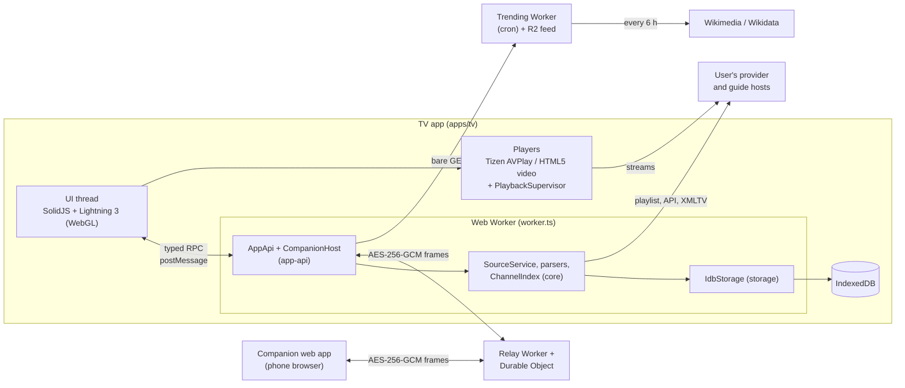
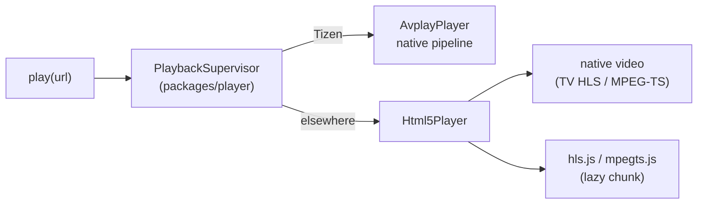

# Architecture

Saqqezy Player is a TV player for the user's own M3U playlists, Xtream logins and XMLTV guides. It ships with no
content and runs no media servers: the device downloads playlists, guides and streams straight from the hosts the
user configured. This page describes how the code is split, how data and video move through it, and how it is
tested. Security and privacy properties are in [SECURITY-MODEL.md](SECURITY-MODEL.md); the product and legal rules
that shape the design are in [GUARDRAILS.md](GUARDRAILS.md).

## Runtime components



- **UI thread.** Lightning 3 draws the interface on a transparent WebGL canvas above a video layer (a `<video>`
  element, or Samsung's video plane under AVPlay). `src/input/keys.ts` is the only raw key listener; it maps
  device keys through `@iptv/platform` and re-dispatches logical keys to Lightning's focus manager. The UI holds no
  catalogue: it asks the worker for pages.
- **Web Worker.** `apps/tv/src/worker.ts` builds `IdbStorage`, a fetch with timeouts, `SourceService`,
  `VodService`, the subtitle services and `AppApi`, then serves `AppApi` over `postMessage` with `expose()`. In the
  production build `@iptv/core` ends up only in the worker chunk. All parsing, storage and networking for sources
  happens here.
- **Direct provider access.** Playlists, Xtream API calls, guides and streams go from the device to the user's
  hosts. In `vite dev` only, `apps/tv/vite.proxy.ts` forwards these requests from the developer's machine so a
  desktop browser can bypass CORS; it is never part of a build (see [SECURITY-MODEL.md](SECURITY-MODEL.md)).
- **Companion.** `apps/companion` is a phone web page that pairs with the TV and manages sources, lists and groups.
  The two talk through `services/relay`, which forwards ciphertext between one TV socket and one phone socket
  ([services/relay/README.md](../services/relay/README.md)).
- **Trending feed.** `services/trending` builds a public JSON feed of popular film and series ids from Wikimedia
  pageviews and Wikidata every 6 h and serves it from R2. The TV fetches it with a bare GET and matches it against
  the library on the device ([services/trending/README.md](../services/trending/README.md)).
- **Site.** `apps/site` is a static marketing page; it has no runtime connection to the app.

## Packages and dependency direction

| Package | Depends on (`@iptv/*`) | Role |
|---|---|---|
| `packages/core` | none | Pure logic: M3U parser, Xtream client, streaming XMLTV parser, `ChannelIndex`, settings, `SourceService`, `VodService`, the `Storage` interface |
| `packages/storage` | core | `IdbStorage` (TVs, browsers) and `MemoryStorage` (tests), both implementing core's `Storage` |
| `packages/companion-protocol` | core | Pairing secrets, frame sealing, replay window, `SecureChannel`, typed messages, WebSocket relay transport |
| `packages/app-api` | core, companion-protocol | `AppApi` (the API the UI calls), `CompanionHost`, the typed RPC (`rpc.ts`), controllers for VOD, catch-up, subtitles, sports, search |
| `packages/player` | none | `Player` interface, `PlaybackSupervisor`, recovery policy, reconnect budget, live delay, playback journal |
| `packages/platform` | none | Platform detection, remote key maps, per-platform profiles |
| `apps/tv` | all of the above | Screens, players (`AvplayPlayer`, `Html5Player`), worker entry, dev proxy |
| `apps/companion` | core, companion-protocol | Phone UI |
| `services/relay`, `services/trending` | none | Cloudflare Workers |
| `tools/fake-xtream` | core | Local synthetic provider for development and tests |

Dependencies point one way: apps depend on packages, packages never import apps, and `core`, `player` and
`platform` import no other workspace package. `app-api` sees storage only through core's `Storage` interface; the
concrete `IdbStorage` is chosen in `worker.ts`. Nothing in `packages/*` touches the DOM or Lightning, so it all runs
under Node in tests.

## Loading a source

The design rule is stale-while-revalidate: never block the UI on a playlist or guide download.

1. **Cold start from cache.** The UI calls `api.init()`. `AppApi.activate()` reads the active source's stored
   channels, layout (lists, hidden channels, renames, order), guide coverage, settings and detected regions from
   IndexedDB in parallel and builds a `ChannelIndex`. The UI can draw and play the last channel from this state with
   no network request.
2. **Background refresh.** `startBackground()` queues one pass per source: the playlist when it was never fetched,
   the cache is empty, or it is older than `autoRefreshHours`; then the guide on the same rule. A failed automatic
   refresh holds the next one off for 15 min, 1 h, then 6 h. A source that answered with a refusal status is in a
   cooldown (`RefusalGuard`) and gets no requests at all until it ends.
3. **Streaming parse in the worker.** `responseText()` decodes the body as it arrives (gzip through
   `DecompressionStream`), `parseM3u()` and `parseXmltv()` (a `saxes` SAX parser) are async generators over those
   text chunks, so a large file is never held as one string. Downloads get 90 s to first byte and fail after 30 s
   without data. The guide is written to IndexedDB in batches of 5,000 programmes (1,000 on TVs, so a guide read
   waits behind a shorter write), and the import yields the thread every 8 ms of work so UI requests are answered
   during the import.
4. **Index and swap.** After the new channel list is stored, the index is rebuilt and the worker emits
   `refreshed`. Until then the UI keeps showing the cached index. Title and sports indexes for search and the Start
   page are built from the guide during its import.
5. **Paged queries.** The UI never receives a whole list. It asks for slices: `getChannelSlice(group, offset,
   count)`, `getEpgRows(group, offset, count, from, to)` for the guide (pages of 20 channels by 3 h chunks, held in a
   bounded `EpgCache` of 24 entries that expire after 15 min) and `getVodSlice(...)` for movie grids (48 tiles per
   page). Lists are virtualised, so a large group costs the rows on screen, not the whole list.

RPC (`packages/app-api/src/rpc.ts`): each call is `{ id, method, args }` over `postMessage`, answered with a value
or a serialised error (only name, message, status and code cross the port). `expose()` accepts only the methods in
`APP_API_METHODS`; anything else, including names on `Object.prototype`, is rejected. Events (progress, refreshed,
layout changes) flow the other way.

## Playback pipeline



- **Native first.** On Tizen the player is AVPlay on Samsung's video plane; elsewhere it is `Html5Player` on a
  `<video>` element. `Html5Player` plays HLS natively when the TV's element supports it and uses hls.js otherwise
  (desktop Chrome never prefers native HLS, see [apps/tv/STACK.md](../apps/tv/STACK.md#player)); `.ts` streams go
  through mpegts.js. hls.js and mpegts.js live in their own chunk that AVPlay platforms never load.
- **Format fallback.** Core's `alternateStreamUrl` maps an Xtream live URL to the other format (`.ts` and the
  extensionless short form to `.m3u8`, `.m3u8` to `.ts`). After two failed attempts (`failuresBeforeAlternate`) the
  supervisor tries the alternate.
- **Supervisor** (`packages/player/src/supervisor.ts`, policy in `recovery.ts`). It watches progress every 250 ms
  and walks a stall ladder: jump small buffer gaps, seek to the live edge, reconnect when no bytes arrive (2.5 s),
  the buffer stays empty (4 s), the picture freezes (3 s) or a stall lasts 8 s. Reconnects back off 1, 2, 4, 8,
  15 s with 20 % jitter, are capped by a budget of 6 per minute and 20 per 10 min, and keep at least 1 s (plus up to
  300 ms) between opens, because many sources allow one connection per account and treat fast reconnects as a
  second one. A refusal status (401, 403, 429 and similar) gets at most one immediate retry and the other format,
  and the source's refusal cooldown then blocks further probes while it lasts. After the budget runs out, a stream that had
  played gets three background retries (30, 60, 120 s).
- **Live delay.** `LiveDelayController` keeps a live stream near a preset delay behind the edge: it raises the
  target after stalls (remembered per source), eases it back after a quiet minute, and asks for a seek, a gentle
  rate change (where allowed) or a reopen when the stream drifts.
- **Journal.** Every decision is written to a 200-event playback journal in `localStorage`, without URLs or
  credentials, and shown under Settings, Diagnostics.

Background: [research/playback-robustness-2026-10.md](research/playback-robustness-2026-10.md) and the live latency
notes ([r1](research/live-latency-2026-10/r1-web-engines-latency.md),
[r2](research/live-latency-2026-10/r2-tizen-webos.md), [r3](research/live-latency-2026-10/r3-media3-libmpv.md),
[r4](research/live-latency-2026-10/r4-input-lag.md), [r5](research/live-latency-2026-10/r5-stalls-recovery.md)).

## Companion pairing

```mermaid
sequenceDiagram
  participant TV as TV worker (CompanionHost)
  participant R as Relay (Durable Object)
  participant Ph as Phone (companion page)
  TV->>TV: start('qr'): random sessionId + key, or start('code'): PBKDF2(code) gives both
  TV->>R: WS /v1/session/{sessionId}/ws?role=tv
  Note over TV: shows QR ({origin}/#s=..&k=..) or XXXX-XXXX-XXXX
  Ph->>Ph: read fragment (then strip it) or derive from typed code
  Ph->>R: WS /v1/session/{sessionId}/ws?role=phone
  Ph->>R: sealed hello
  R->>TV: forwards ciphertext unchanged
  TV->>R: sealed welcome; state on getState
  R->>Ph: forwards ciphertext unchanged
  Note over TV,Ph: ops, sources, pings every 25 s; TV ends the session at 15 min unpaired / 60 min paired
```

One session at a time; pairing secrets live only in memory. Both sides wrap the relay socket in a long-lived
transport that reconnects internally, and one `SecureChannel` per session keeps its message counter and replay
window across reconnects. The crypto is detailed in [SECURITY-MODEL.md](SECURITY-MODEL.md); deployment is in
[deploy-companion.md](deploy-companion.md).

## Lazy screens and the start-bundle check

Every byte in the start bundle is parsed and compiled on each launch, which is slow on a TV CPU. Screens that a cold
start or the first key press can show (Live TV with the guide, the player, Start, Movies and series, Search, Add
source) stay in the start bundle. Rare screens load on first use through `lazyModule()`
(`apps/tv/src/shell/lazyModule.ts`): the VOD player, Settings (with its pages and the QR pairing page), Countries
and Multiview. They are also preloaded one per idle slot after the first channel row, and the detail screens
prefetch the VOD player. A failed chunk load shows "Try again", which reloads the app.

[`tools/build/chunkCheck.mjs`](../tools/build/chunkCheck.mjs) guards this split. Run it on a build made with
`vite build --sourcemap`; it takes the entry chunk named by `index.html` plus every chunk it imports statically
(transitively), reads their source maps, and exits 1 if any of them contains a lazy-only module: `saxes`,
`xmlchars`, `qrcode-generator`, `QrCode.tsx`, `Countries.tsx`, `Settings.tsx`, the settings pages, `Multiview.tsx`
or the VOD player. It also prints the entry and total start-bundle sizes. Its logic is unit-tested in
`tools/build/test/chunkCheck.test.ts`; the check itself is run by hand, not in CI.

## Testing

- **Unit and fixture tests** (`pnpm test`, Vitest, config in `vitest.config.ts`): `packages/**/test`,
  `tools/**/test`, `services/**/test`, and the `*.test.ts` files in `apps/tv/src` and `apps/companion/src`, all in
  a Node environment. Parsers are tested against synthetic playlists and guides (`packages/core/test/fixtures`);
  no real channels or provider data are used. UI logic is kept in pure modules next to the screens so it can be
  tested without a renderer. The relay's session logic runs under a fake clock (`sessionCore.test.ts`).
- **Relay integration** (`pnpm relay:test:int`) runs against a local `wrangler dev` relay with random synthetic
  sessions; it is not part of `pnpm test`.
- **Perf budgets** (`pnpm test:perf`, [vitest.perf.config.ts](../vitest.perf.config.ts), files
  `packages/**/perf/*.perf.ts`, forked workers with `--expose-gc`). Inputs are generated (`packages/core/perf/generate.ts`).
  Examples: a 50k-channel M3U parsed, indexed and queried in under 2 s; a 50k-channel index rebuild with a large
  layout under 300 ms; a ~100 MB XMLTV guide streamed with heap growth under 150 MB; a 54k-channel guide import
  during which API calls answer with p95 under 15 ms and no wait over 50 ms (150 ms for the first sample).
- **CI** ([.github/workflows/ci.yml](../.github/workflows/ci.yml)) runs on pushes to `main` and on pull requests:
  `pnpm install --frozen-lockfile`, `pnpm typecheck` (strict TypeScript over every package), `pnpm test`, then
  `pnpm test:perf` with `continue-on-error`, since timing budgets tuned on a quiet machine are a signal on a shared
  runner, not a gate.
- **Devices.** The Tizen build has been installed and profiled on one Samsung device, an Odyssey G9 monitor
  ([research/g9-performance-2026-10.md](research/g9-performance-2026-10.md),
  [install-on-samsung.md](install-on-samsung.md)). Other TV models are untested. The device targets in
  [GUARDRAILS.md](GUARDRAILS.md) (1 s cached start, 100 ms channel switch, a 300 MB guide on 1 GB of RAM) are not
  yet measured.
